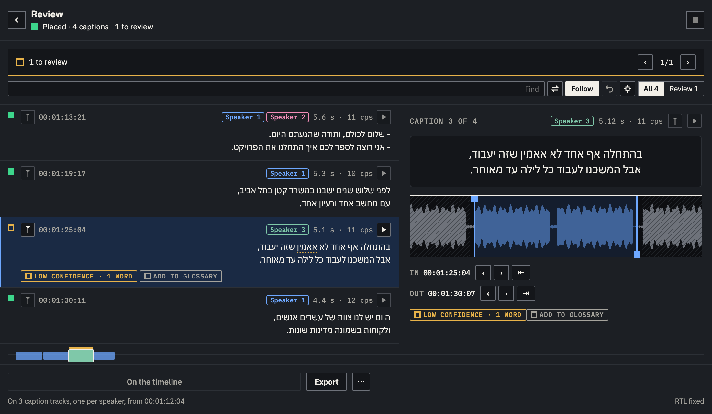

<h1>
  <picture>
    <source media="(prefers-color-scheme: dark)" srcset="brand/png/lockup-dark.png">
    
  </picture>
</h1>
<p>
  <picture>
    <source media="(prefers-color-scheme: dark)" srcset="brand/conformlabs-endorsement-reversed.svg">
    
  </picture>
</p>

[](https://github.com/ConformLabs/cueline/actions/workflows/ci.yml)

**Cueline turns the speech in a Premiere Pro sequence into captions on a caption track, on your computer.**
It is made for Hebrew first, with ivrit.ai's model, and works in 99 other languages. Every caption is timed against the
audio, checked against your caption style, fixed where it breaks it, and ready to review with the waveform and
playback in Premiere Pro. Speakers are told apart by voice. Nothing is uploaded.



- **Captions timed from the audio:** each caption starts and ends where the speech does, not where the model guessed.
- **A style it checks and fixes:** reading speed, line length, lines, duration. Broadcast, Social, One word, or your own.
  Line breaks follow subtitle rules, including Hebrew's.
- **Speakers:** by voice or by audio track, a new caption on every change, dialogue dashes, a caption track per speaker,
  names you give them, unsure ones flagged for you.
- **Review:** waveform with draggable in and out, playback in Premiere Pro, follow the playhead, fillers, find and
  replace, undo. Batch for several sequences.
- **Premiere Pro:** 2022 or later, on macOS 12+ (Apple silicon and Intel) and Windows 10/11.
- **Install:** signed and notarized `.pkg` for Mac, signed `Setup.exe` for Windows, from
  [Releases](https://github.com/ConformLabs/cueline/releases/latest). No administrator rights, no account. Free and open
  source (MIT).
- **Help:** [the wiki](https://github.com/ConformLabs/cueline/wiki): installing, the panel, speakers, troubleshooting.

Premiere Pro's scripting can add caption tracks but not change them, so updating the timeline after edits adds a new
caption track. On Windows, transcription runs on the CPU; on a Mac, on the GPU (Metal).

```
sequence audio ──> whisper.cpp (words) ──> timing from the audio ──> style check and fixes ──> caption track
                   speaker detection (sherpa-onnx) ──┘
```

## Repository

| Folder | What |
|---|---|
| `extension/` | the Premiere Pro panel (CEP): `js/panel.js` (screens), `js/cues.js` (caption engine, no DOM), `js/engine.js` (whisper.cpp and speaker tools, Node), `js/host.js` (Premiere bridge, or a simulated one in a browser), `jsx/host.jsx` (ExtendScript) |
| `native/` | `voiceprint.c`, the voice-print helper built on sherpa-onnx's C API |
| `scripts/` | builds, signing, installers, release |
| `installer/` | the Conform Labs installer frame (`common/`) and Cueline's pages |
| `brand/` | logo, icons, colours |
| `notes/` | release notes, one file per version (the release body, shown in the panel's Updates screen) |
| `docs/wiki/` | the [wiki](https://github.com/ConformLabs/cueline/wiki)'s pages (copied to the wiki repository) |
| `media/` | screenshots (`extension/index.html?demo=review` in a browser) |
| `test/` | `node test/cues.test.js` |

## Develop

```sh
npm run build:mac            # whisper-cli (universal) and the speaker tools into extension/engine/mac
ln -s "$PWD/extension" ~/Library/Application\ Support/Adobe/CEP/extensions/com.conformlabs.cueline
defaults write com.adobe.CSXS.11 PlayerDebugMode 1   # unsigned development copy
npm test
```

Open `extension/index.html` through any static server to preview the panel with a simulated Premiere Pro.

## Release

`npm run release -- 1.0.1 --notes notes/release-1.0.1.md` stamps the version, checks, builds the signed and notarized
Mac installer and the Windows Setup, and publishes the GitHub release. See `scripts/release.mjs`.

MIT licence (see `LICENSE`). Adobe and Premiere Pro are either registered trademarks or trademarks of Adobe in the
United States and/or other countries; Cueline is not affiliated with or endorsed by Adobe.

Built on whisper.cpp (MIT), ivrit.ai models (Apache-2.0), sherpa-onnx (Apache-2.0), pyannote segmentation (MIT),
3D-Speaker CAM++ (Apache-2.0), Silero VAD (MIT) and IBM Plex (OFL). See `PRIVACY.md` for every network request.
